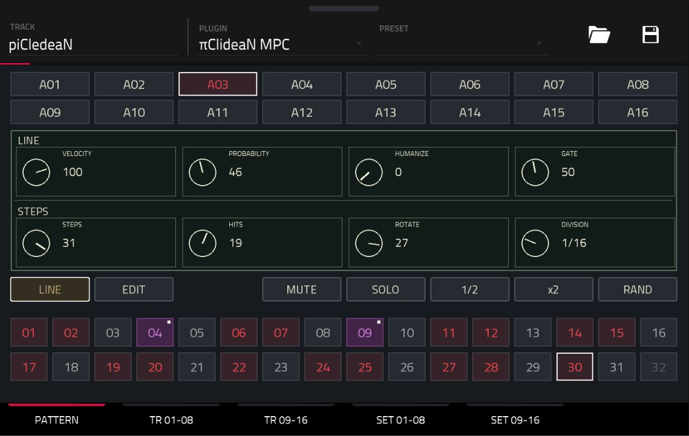

# πClideaN 16 MPC

**Version 1.1.2 · Sixteen-lane Euclidean MIDI sequencer for Akai MPC OS**



Build evolving drum patterns with sixteen independent lanes, per-step expression and a native touch interface. Drive a Drum Track or a drum instrument through the plugin's dedicated MIDI output.

## Features

- Sixteen lanes with 1–32 steps each.
- Euclidean Steps, Hits and Rotate controls, with five rhythmic divisions.
- Per-lane velocity, probability, velocity humanization and gate length.
- Per-step velocity, probability, ratchet and ratchet decay.
- Forward, reverse, two pendulum modes and shuffled traversal.
- Automatic pattern rotation at a configurable cycle interval.
- Per-lane GATE / HOLD for short hits and sustained notes.
- Touch selection, note drawing, contextual erase, mute and solo.
- Azure activity pulses on all sixteen lane buttons during playback.
- Eight contextual Q-Link controls and native project state storage.
- Independent MIDI client, output port and scheduling queue for each instance.

The plugin generates MIDI only. Use a separate Drum Track or drum instrument to produce sound. The plugin appears as **πClideaN MPC** in the instrument list; code, binary and MIDI identifiers use ASCII `pi`.

## Download and setup

Install [piClideaN-MPC-1.1.2-armv7.zip](Installation/piClideaN-MPC-1.1.2-armv7.zip) with a compatible portable-package installer. See [Installation and removal](docs/INSTALLATION.md).

## Documentation

- [User manual](docs/USER-MANUAL.md) · [Standalone illustrated manual](docs/USER-MANUAL.html)
- [MIDI engine](docs/ENGINE.md)
- [Implementation](docs/IMPLEMENTATION.md)
- [Build from source](docs/BUILD.md)
- [Third-party notices](THIRD_PARTY.md)

## Repository layout

```text
Installation/       Installable ARMv7 ZIP and checksum
src/                MIDI engine
scripts/            Parameter, skin, build and package tools
docs/               User and developer documentation
reference/          Skin schema, note map and font inputs
third_party/        Pinned wrapper, generator and ALSA headers
licenses/           Dependency license notices
params.json         Parameter definitions
params.lock         Fixed parameter indices
vst.json            Plugin build configuration
```

## Requirements

Akai Gen1 (Tested on Akai FORCE) running an OS environment that supports community ARMv7 VST2 plugins and native plugin skins. This is not a stock firmware add-on installer. SSD installation requires executable access to the SSD's `Synths` directory. The package uses regular files and requires no symbolic links.

## License

MIT. See [LICENSE](LICENSE) and [THIRD_PARTY.md](THIRD_PARTY.md).
