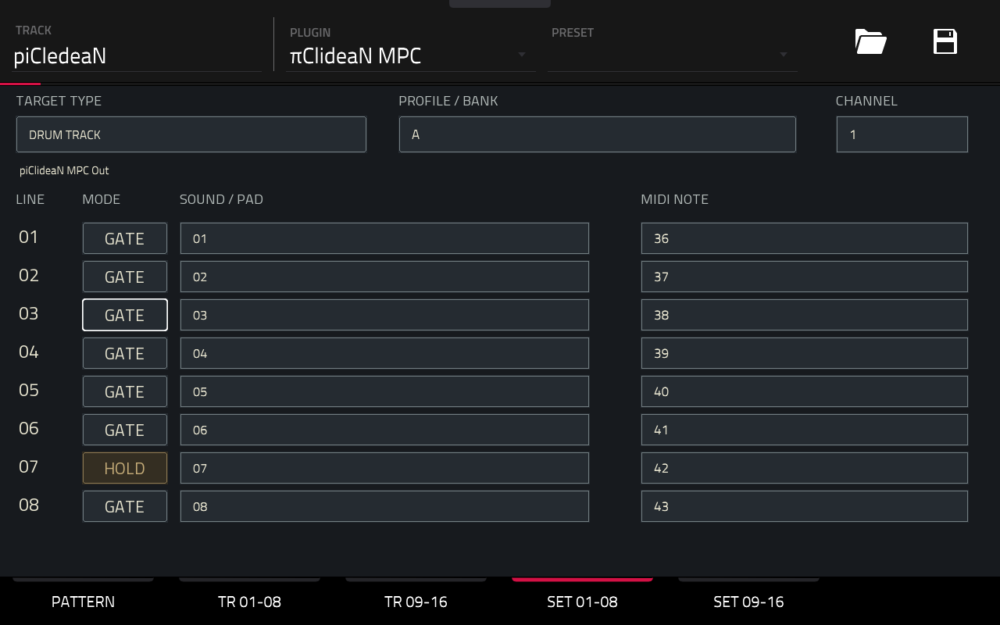
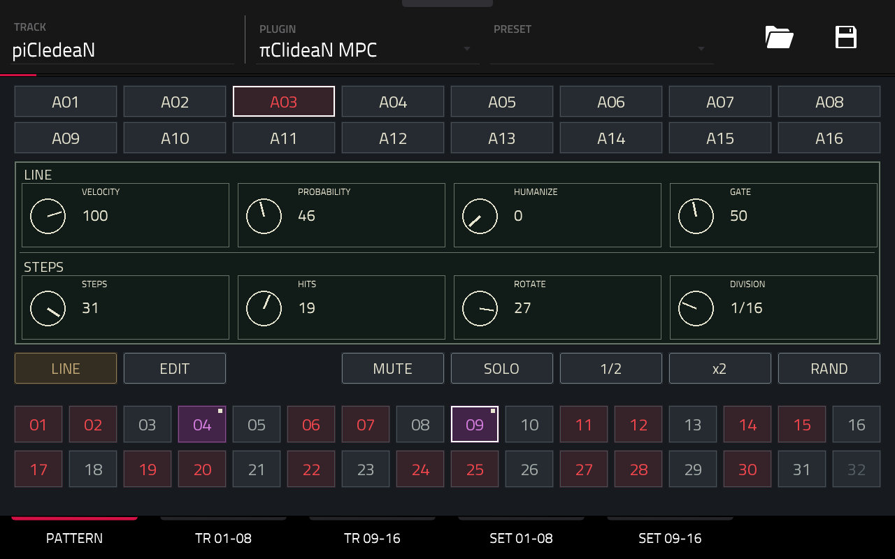
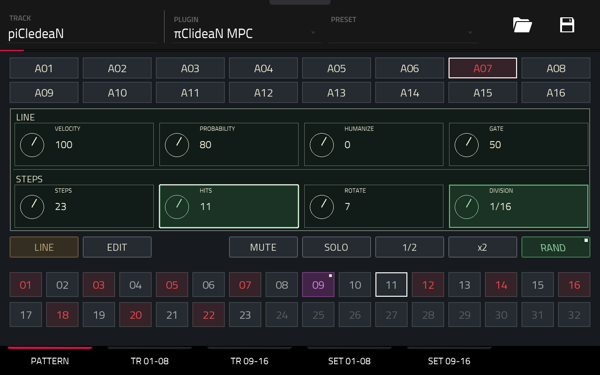
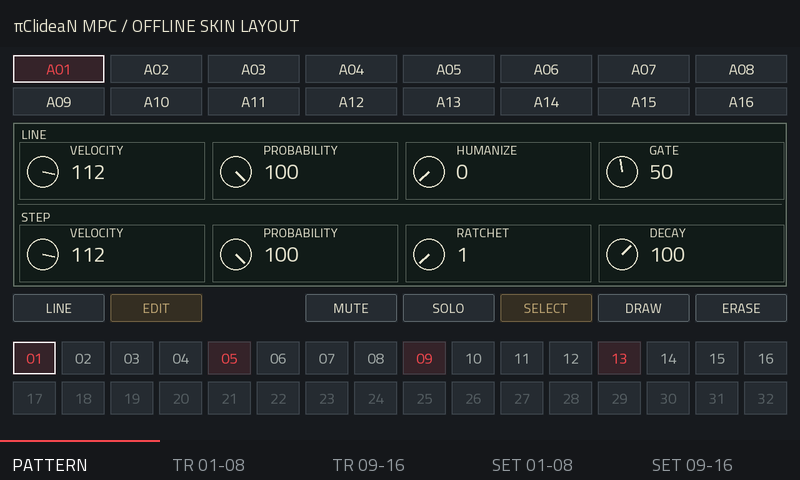
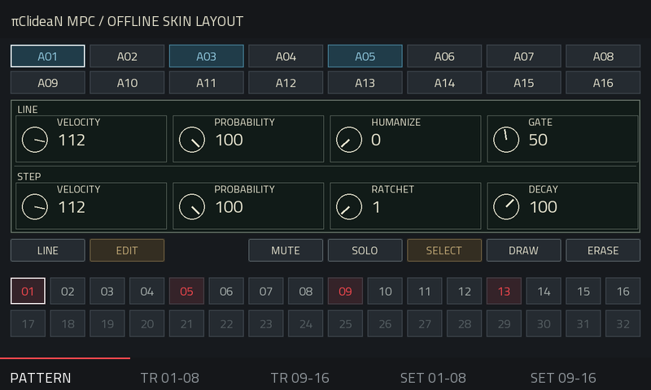
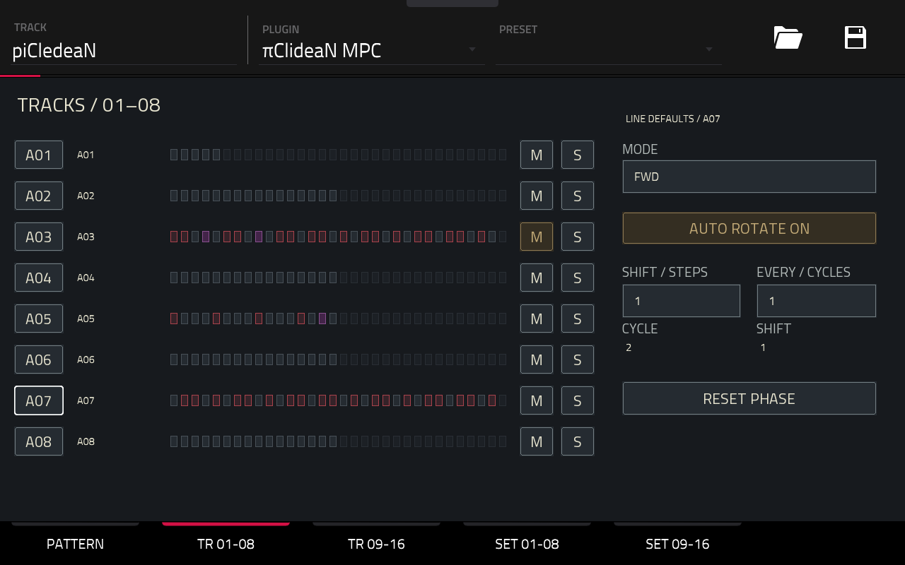
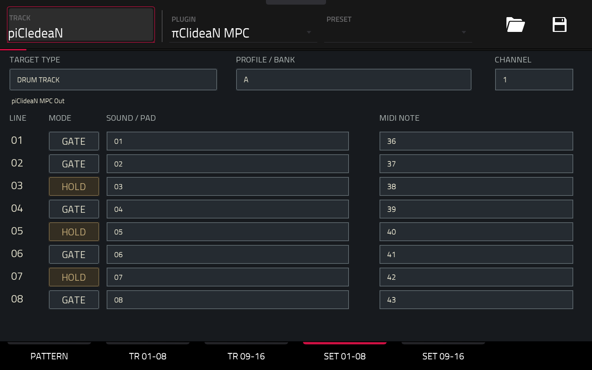

# πClideaN16 MPC — User Manual

Version 1.2.1

## 1. Overview

πClideaN provides sixteen independent rhythmic lanes. 
Each lane triggers one MIDI note on a shared output channel. 
Use the lanes for individual Drum Track pads or the sounds of a drum instrument.

The five pages are PATTERN, TR 01-08, TR 09-16, SET 01-08 and SET 09-16. 
Lane buttons A01–A16 select a sequencer lane.

## 2. Connect a target

On the target track, choose `piClideaN MPC Out` as an input and match its channel to SET. In SET, choose DRUM TRACK or DRUM INSTRUMENT and adjust each lane's pad or MIDI note. Start the Force transport to run the sequencer.

Each instance owns a separate MIDI output. Additional instances use numbered port labels. Select the correct output on each target.

DRUM TRACK is the default target. Bank A provides notes 36–51 as the initial sixteen-pad mapping. Bank selection applies the supplied note table; it does not inspect another track. Notes remain editable. DRUM INSTRUMENT provides named sounds and an Incipience note-map action; check the instrument's note assignments before applying it. Mapping changes do not rewrite the rhythm.

## 3. PATTERN — LINE

Choose a lane with A01–A16, then choose LINE.

The upper LINE row sets common expression:

- VELOCITY: 1–127.
- PROBABILITY: 0–100 percent chance of playing a trigger group.
- HUMANIZE: random velocity variation, 0–50, applied once per trigger group.
- GATE: 10–95 percent of the step or ratchet subdivision, used in GATE mode.

The lower STEPS row sets the Euclidean pattern:

- STEPS: lane length, 1–32.
- HITS: number of evenly distributed hits, 0–STEPS.
- ROTATE: circular offset of the generated pattern.
- DIVISION: step duration, 1/32, 1/16, 1/8, 1/4 or 1/2 note.

Manual trigger edits take precedence over the generated pattern. Steps outside the current length are dimmed; their stored data is retained.

MUTE silences the lane. SOLO limits playback to soloed lanes; multiple lanes can be soloed. Mute takes precedence over solo. Active buttons use amber.

1/2 makes the lane run more slowly by moving to the next available division. x2 moves to the faster division.

### Gate length — how long a MIDI note stays held

The GATE knob in the upper LINE row controls the time between each Note On and its Note Off when that lane is in GATE mode on the SET page. Its range is 10–95 percent of one step duration. This is a MIDI note duration, not a volume control or a sample-length setting.

- Lower values release the note sooner: useful for short, detached hits when the target responds to Note Off.
- Higher values hold the note longer, up to 95 percent of the step duration.
- At 120 BPM with DIVISION set to 1/16, a step lasts 125 ms. GATE 50 sends Note Off about 62.5 ms after Note On; GATE 10 gives about 12.5 ms, and GATE 95 about 118.75 ms.
- With RATCHET, the percentage applies to each repetition's subdivision. At the same tempo and division, RATCHET 4 divides the step into four 31.25 ms intervals; GATE 50 gives each note about 15.625 ms before its Note Off.

The GATE value applies to the entire lane, including steps with their own velocity, probability or ratchet settings. It does not fill rests or wait for the next active step. Note durations can be shortened at a host loop boundary.

The audible effect depends on the target instrument's playback mode and envelope. A One Shot sample may play to its end regardless of Note Off. A gated sample or synthesizer may begin its release stage on Note Off, so its sound can continue after the MIDI note is released. GATE cannot stretch a sample or make it longer than its natural playback.

To hold a note until the next effective trigger on the lane, use HOLD on the SET page. In HOLD mode, the GATE knob's value remains stored but does not determine the note's duration. See **SET pages — GATE / HOLD** below.

### Selective RAND

In this example, lane A07 is active and only HITS and DIVISION are selected in green. Pressing RAND again randomizes those two settings. The other six lane controls keep their values. The small white square on RAND indicates selection mode; a white outline around a control indicates focus, not an additional randomization target.

- Press RAND once to enter selection mode. RAND turns green and italic, with a white square in its upper-right corner.
- Tap any of the eight control areas to include or exclude that parameter. Included areas turn green. Touching them does not change their values.
- Press RAND again to randomize only the selected parameters on the current lane. RAND and all selection indicators return to their normal appearance.
- With no parameters selected, the second press closes selection without changing the lane.
- Selection is cancelled when choosing another lane or changing LINE/EDIT mode. Selection is not stored in the project.
- The 1/2 and x2 controls remain visible; their actions and contextual Q-Link editing are inactive during selection.

Available targets: Velocity, Probability, Humanize, Gate, Steps, Hits, Rotate and Division. New Steps values respect unselected Hits and Rotate. Manual trigger overrides are cleared only when Steps, Hits or Rotate actually changes; per-step velocity, probability, ratchet and decay are retained. A random result may equal the previous value.

## 4. PATTERN — EDIT

In EDIT, the upper LINE row is dimmed and shows the lane defaults as read-only references. Touch, the data wheel and Q1–Q4 cannot edit these four controls. Return to LINE to change them. Existing host automation of canonical lane parameters continues to run. The lower STEP row remains active and edits the selected step:

- VELOCITY: replaces the lane velocity for this step.
- PROBABILITY: replaces the lane probability; it is not multiplied by it.
- RATCHET: 1–8 hits evenly distributed within the step.
- DECAY: ratchet velocity multiplier, 0–150 percent. 100 keeps the same velocity; lower values fade repeats, higher values increase them up to 127. With a single hit it has no effect. At 0, only the first hit plays.

A small square marks a custom step value. Without a custom value, velocity and probability follow the line; ratchet defaults to 1 and decay to 100.

### Select, draw and erase

SELECT touches a step without changing its trigger. DRAW toggles its trigger on each touch. Changing expression does not create a trigger.

In SELECT, ERASE clears the selected step's custom expression values while retaining its trigger. In DRAW, ERASE removes its trigger while retaining its expression settings. Changes are immediate; there is no undo history.

### Muted lanes and activity

The A01–A16 selectors are dimmed when their lanes are explicitly muted. A muted selected lane keeps its white selection border and uses an attenuated red label. Touching a muted lane selects it without unmuting it. Solo exclusion alone does not dim the other lane selectors.

The A01–A16 buttons briefly illuminate in azure when their scheduled Note On reaches playback time. This shows the activity of all sixteen lanes while PATTERN displays the selected lane's steps. The selected lane keeps its white outline.

Muted lanes, solo-excluded lanes, rests and rejected probability decisions do not flash. Ratchets contribute to the pulses; rapid repeats can merge visually. HOLD indicates retriggers, not the duration of the sustained note. Each impulse lasts approximately 140 ms, subject to the native screen refresh cadence. It indicates emitted MIDI activity rather than measured audio from the target.

In this capture, A03 flashes in azure because it has triggered a note, while A13 remains selected with its white outline. The displayed pattern and controls belong to A13: lane activity feedback does not change the selected lane.

### Colors

- Red: an active trigger without custom expression.
- Violet: a step with custom expression, including a silent step.
- Dark: an unmodified rest.
- White outer border: selected step.
- Red inner border: playback position.
- Amber buttons: active modes and toggles.

A violet rest remains silent until its trigger is enabled. A custom value can equal the line default while remaining independently stored.

## 5. TR pages — playback and rotation

TR 01-08 and TR 09-16 show eight lanes each. Tap A01–A16 to select a lane; its button gains a white outline and the controls on the right follow that lane. In the screenshot, A07 is selected.

### Reading the lane overview

Each row shows the lane button, its assigned sound or pad name, a 32-step preview, and M / S buttons.

- Dark tiles represent rests; steps beyond the lane length are dimmed.
- Dark red tiles with red outlines indicate active hits without custom step-expression values.
- Purple tiles indicate steps with custom expression values. They can also represent a rest with stored values; purple alone does not guarantee a note will play.
- A light outline marks the playback position while the transport is running. It is separate from the red or purple step colour.
- Patterns can remain visible on muted lanes: the overview shows stored rhythm data, not proof of an audible note.

### Mute and Solo

- Tap **M** to mute that lane. Its M button stays amber until tapped again. In the screenshot, A03 is muted.
- Tap **S** to solo that lane. Its S button stays amber until tapped again. Multiple lanes can be soloed together.
- When any lane is soloed, only soloed lanes can play. Mute takes precedence, including on a soloed lane.

These buttons work by touch and affect their own row, independently of which lane is selected for the right-hand controls.

### Playback mode

Playback modes:

- FWD: first to last step.
- REV: last to first step.
- PEND1: forward and backward, repeating both endpoints.
- PEND2: forward and backward without repeating endpoints.
- URN: visits every step once in a shuffled order per cycle.

For four steps, PEND1 visits 1–2–3–4–4–3–2–1; PEND2 visits 1–2–3–4–3–2. A one-step lane always visits that single step.

### Automatic rotation

Tap AUTO ROTATE to switch rotation on or off for the selected lane. The button stays amber when enabled, as shown for A07 in the screenshot.

AUTO ROTATE shifts the pattern content after the chosen number of complete lane cycles. SHIFT is -8 to +8 steps; EVERY is 1–16 cycles. A cycle is based on the playback mode, not necessarily a Force bar. Per-step values move with their triggers. PATTERN and TR show the same rotating content.

### Phase and reset

RESET PHASE requests a fresh phase at the next step boundary while playing. CYCLE and SHIFT display the current phase. The selected step follows its stored data when rotation moves it to another visible position.

## 6. SET pages — GATE / HOLD

Each lane has a GATE / HOLD button in the MODE column, immediately before SOUND / PAD. It is available in both SET 01–08 and SET 09–16 and affects only that lane.

### Using the GATE / HOLD button

- **GATE — normal dark button:** the default mode. Each played note is released automatically after the duration set by the GATE knob on PATTERN. Use this when notes should have a defined, usually short duration.
- **Tap GATE:** the button changes to **HOLD** with an amber background. Each note remains held until the next effective trigger on the same lane. The previous note is released before the new note starts. Use this for a longer sample or sustained sound that should continue between hits.
- **Tap HOLD:** the button returns to **GATE** and its normal dark appearance. The lane uses the GATE knob again. Switching modes releases the currently owned note; the new mode applies to subsequent triggers.

For example, set lane A13 to HOLD to let a long sound continue across empty steps until A13 triggers again. A note played on another lane does not release A13. A rest or a trigger rejected by probability does not end the held note. The sample must still be long enough, and the target must respond appropriately to Note Off.

The SET button selects the **note-duration mode**; the PATTERN knob sets the **duration percentage used in GATE mode**. These are two different controls. Each lane can use a different mode, and the choices are saved with the Force project.

### Release behaviour and target setup

- Rests and probability-rejected triggers leave a held note playing.
- Each audible ratchet retriggers; the final repeat remains held.
- Stop, Mute, exclusion by Solo and switching GATE / HOLD release the owned note.
- Note, channel, routing and playback-geometry changes use the engine's note-release safeguards.
- The Gate percentage remains stored while HOLD is active, but does not set the held note's duration.

HOLD cannot extend a sample beyond its natural end. The target must respond to Note Off and use a suitable envelope/release. A One Shot sample may ignore Note Off. Use distinct notes for independent lanes: two lanes sharing a note and channel are subject to overlap protection.

## 7. Q-Links and automation

On PATTERN in LINE mode, Q1–Q4 control line Velocity, Probability, Humanize and Gate. These four contextual controls are inactive in EDIT, where the dimmed LINE row remains visible as a reference. Q5–Q8 control Steps, Hits, Rotate and Division in LINE, or selected-step Velocity, Probability, Ratchet and Decay in EDIT.

TR pages expose lane selection, playback mode, rotation, shift and interval. SET pages expose lane selection, target, channel and bank. A white focus border identifies the control operated by the data wheel.

Canonical lane and step parameters are exposed separately for host automation. Contextual Q-Link aliases depend on the visible selection and are not advertised as automation targets. Step automation addresses stored source steps, which can move on screen under automatic rotation.

Q-Link automation inside the host is distinct from MIDI CC input. This plugin does not record or replay CC messages.

## 8. Save and playback

Save the Force project to store all sixteen patterns, step overrides, note assignments, GATE / HOLD choices and playback settings. The sequencer follows host tempo, position and loop boundaries. Stop releases its owned notes.

Probability is calculated once for a complete ratchet group and is deterministic for a given lane seed and musical position. A repeating host loop can therefore repeat the same probability decisions.

The plugin does not create native clips, control physical pad LEDs or synthesize audio. Scheduling has bounded event and loop budgets; see the engine documentation for the limits.
