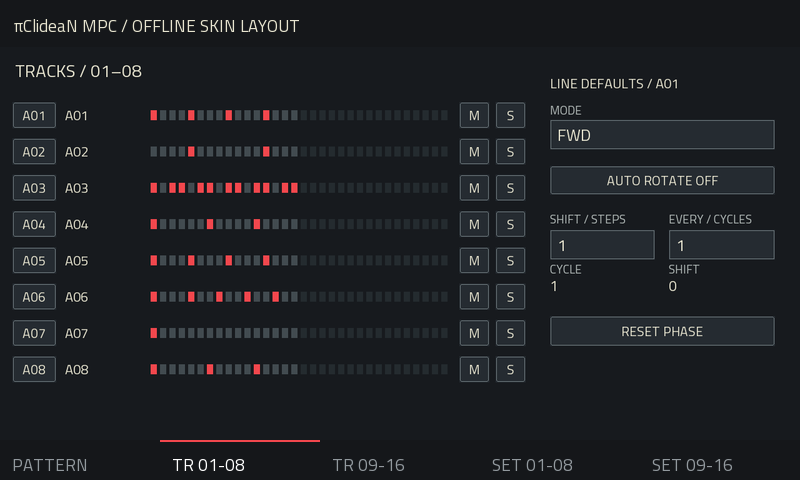

# πClideaN16 MPC — User Manual

Version 1.1.2

## 1. Overview

πClideaN provides sixteen independent rhythmic lanes. Each lane triggers one MIDI note on a shared output channel. Use the lanes for individual Drum Track pads or the sounds of a drum instrument.

The five pages are PATTERN, TR 01-08, TR 09-16, SET 01-08 and SET 09-16. Lane buttons A01–A16 select a sequencer lane; their labels are not a guarantee of the target's current note mapping.

## 2. Connect a target

On the target track, choose `piClideaN MPC Out` as an input and match its channel to SET. In SET, choose DRUM TRACK or DRUM INSTRUMENT and adjust each lane's pad or MIDI note. Start the Force transport to run the sequencer.

Each instance owns a separate MIDI output. Additional instances use numbered port labels. Select the correct output on each target.

DRUM TRACK is the default target. Bank A provides notes 36–51 as the initial sixteen-pad mapping. Bank selection applies the supplied note table; it does not inspect another track. Notes remain editable. DRUM INSTRUMENT provides named sounds and an Incipience note-map action; check the instrument's note assignments before applying it. Mapping changes do not rewrite the rhythm.

## 3. PATTERN — LINE

Choose a lane with A01–A16, then choose LINE.

The upper LINE row sets common expression:

- VELOCITY: 1–127.
- PROBABILITY: 0–100 percent chance of playing a trigger group.
- HUMANIZE: random velocity variation, 0–50, applied once per trigger group.
- GATE: 10–95 percent of the step or ratchet subdivision, used in GATE mode.

The lower STEPS row sets the Euclidean pattern:

- STEPS: lane length, 1–32.
- HITS: number of evenly distributed hits, 0–STEPS.
- ROTATE: circular offset of the generated pattern.
- DIVISION: step duration, 1/32, 1/16, 1/8, 1/4 or 1/2 note.

Manual trigger edits take precedence over the generated pattern. Steps outside the current length are dimmed; their stored data is retained.

MUTE silences the lane. SOLO limits playback to soloed lanes; multiple lanes can be soloed. Mute takes precedence over solo. Active buttons use amber.

1/2 makes the lane run more slowly by moving to the next available division. x2 moves to the faster division. RAND changes the selected lane's Steps, Hits, Rotate and Division, and clears its manual trigger overrides. It keeps per-step expression settings. These actions are immediate.

## 4. PATTERN — EDIT

The upper LINE row retains the lane defaults. The lower STEP row edits the selected step:

- VELOCITY: replaces the lane velocity for this step.
- PROBABILITY: replaces the lane probability; it is not multiplied by it.
- RATCHET: 1–8 hits evenly distributed within the step.
- DECAY: ratchet velocity multiplier, 0–150 percent. 100 keeps the same velocity; lower values fade repeats, higher values increase them up to 127. With a single hit it has no effect. At 0, only the first hit plays.

A small square marks a custom step value. Without a custom value, velocity and probability follow the line; ratchet defaults to 1 and decay to 100.

### Select, draw and erase

SELECT touches a step without changing its trigger. DRAW toggles its trigger on each touch. Changing expression does not create a trigger.

In SELECT, ERASE clears the selected step's custom expression values while retaining its trigger. In DRAW, ERASE removes its trigger while retaining its expression settings. Changes are immediate; there is no undo history.

### Lane activity

The A01–A16 buttons briefly illuminate in azure when their scheduled Note On reaches playback time. This shows the activity of all sixteen lanes while PATTERN displays the selected lane's steps. The selected lane keeps its white outline.

Muted lanes, solo-excluded lanes, rests and rejected probability decisions do not flash. Ratchets contribute to the pulses; rapid repeats can merge visually. HOLD indicates retriggers, not the duration of the sustained note. Each impulse lasts approximately 140 ms, subject to the native screen refresh cadence. It indicates emitted MIDI activity rather than measured audio from the target.

### Colors

- Red: an active trigger without custom expression.
- Violet: a step with custom expression, including a silent step.
- Dark: an unmodified rest.
- White outer border: selected step.
- Red inner border: playback position.
- Amber buttons: active modes and toggles.

A violet rest remains silent until its trigger is enabled. A custom value can equal the line default while remaining independently stored.

## 5. TR pages — playback and rotation

TR 01-08 and TR 09-16 show eight lanes each. Select a lane to edit its settings on the right. M and S control each lane's mute and solo state.

Playback modes:

- FWD: first to last step.
- REV: last to first step.
- PEND1: forward and backward, repeating both endpoints.
- PEND2: forward and backward without repeating endpoints.
- URN: visits every step once in a shuffled order per cycle.

For four steps, PEND1 visits 1–2–3–4–4–3–2–1; PEND2 visits 1–2–3–4–3–2. A one-step lane always visits that single step.

AUTO ROTATE shifts the pattern content after the chosen number of complete lane cycles. SHIFT is -8 to +8 steps; EVERY is 1–16 cycles. A cycle is based on the playback mode, not necessarily a Force bar. Per-step values move with their triggers. PATTERN and TR show the same rotating content.

RESET PHASE requests a fresh phase at the next step boundary while playing. CYCLE and SHIFT display the current phase. The selected step follows its stored data when rotation moves it to another visible position.

## 6. SET pages — GATE / HOLD

Each lane has a GATE / HOLD button before SOUND / PAD. GATE is the default.

GATE sends a Note Off after the calculated gate length. HOLD sustains the note until the next effective trigger on that lane. It releases the previous note before sending the next Note On.

- Rests and probability-rejected triggers leave a held note playing.
- Each audible ratchet retriggers; the final repeat remains held.
- Stop, Mute, exclusion by Solo and switching GATE / HOLD release the owned note.
- Note, channel, routing and playback-geometry changes use the engine's note-release safeguards.
- The Gate percentage remains stored while HOLD is active, but does not set the held note's duration.

HOLD cannot extend a sample beyond its natural end. The target must respond to Note Off and use a suitable envelope/release. A One Shot sample may ignore Note Off. Use distinct notes for independent lanes: two lanes sharing a note and channel are subject to overlap protection.

## 7. Q-Links and automation

On PATTERN, Q1–Q4 control line Velocity, Probability, Humanize and Gate. Q5–Q8 control Steps, Hits, Rotate and Division in LINE, or selected-step Velocity, Probability, Ratchet and Decay in EDIT.

TR pages expose lane selection, playback mode, rotation, shift and interval. SET pages expose lane selection, target, channel and bank. A white focus border identifies the control operated by the data wheel.

Canonical lane and step parameters are exposed separately for host automation. Contextual Q-Link aliases depend on the visible selection and are not advertised as automation targets. Step automation addresses stored source steps, which can move on screen under automatic rotation.

Q-Link automation inside the host is distinct from MIDI CC input. This plugin does not record or replay CC messages.

## 8. Save and playback

Save the Force project to store all sixteen patterns, step overrides, note assignments, GATE / HOLD choices and playback settings. The sequencer follows host tempo, position and loop boundaries. Stop releases its owned notes.

Probability is calculated once for a complete ratchet group and is deterministic for a given lane seed and musical position. A repeating host loop can therefore repeat the same probability decisions.

The plugin does not create native clips, control physical pad LEDs or synthesize audio. Scheduling has bounded event and loop budgets; see the engine documentation for the limits.
