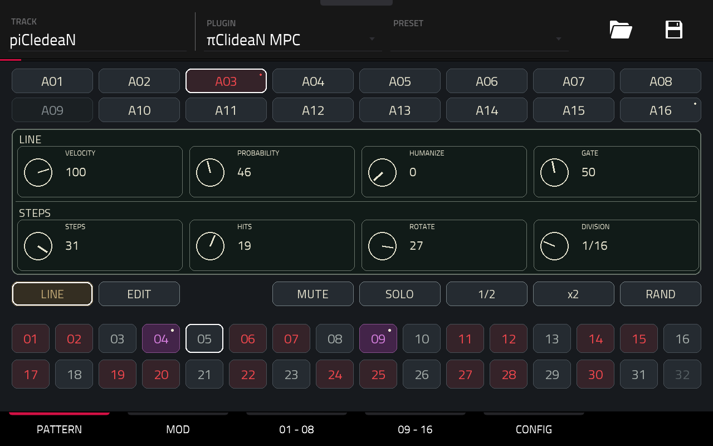
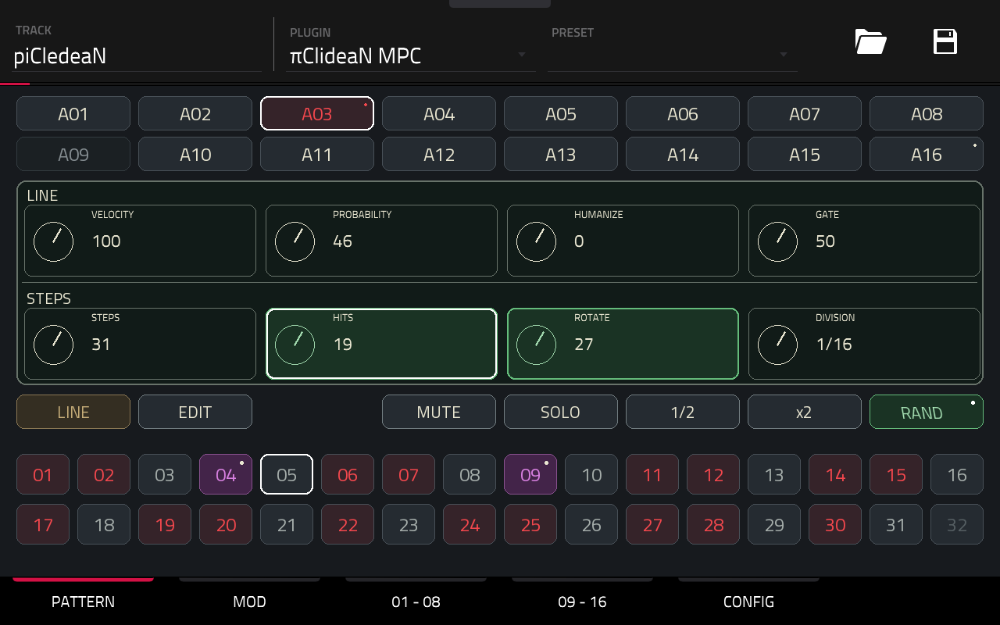
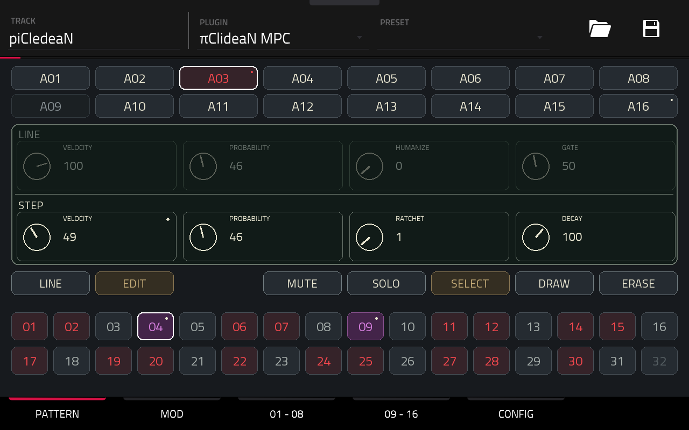
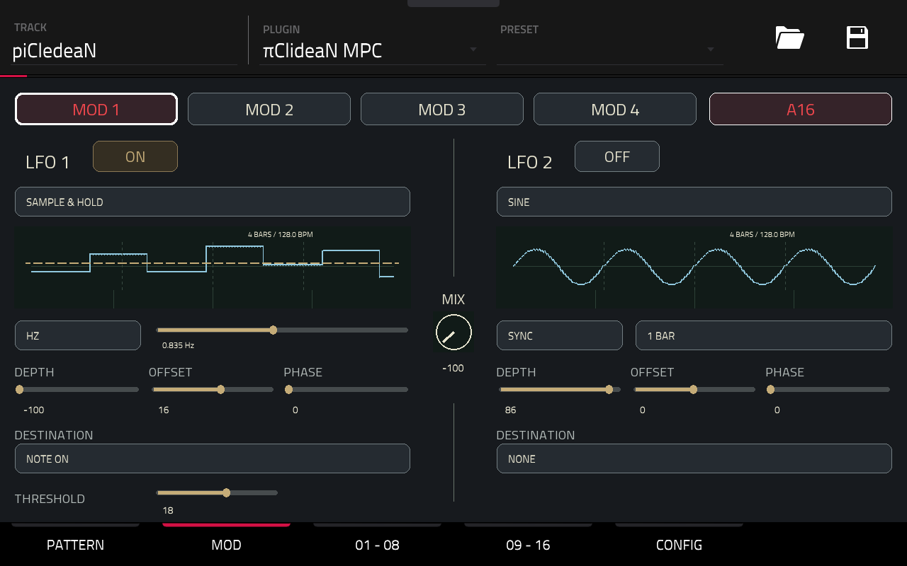
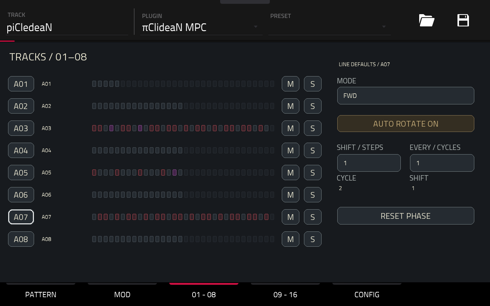
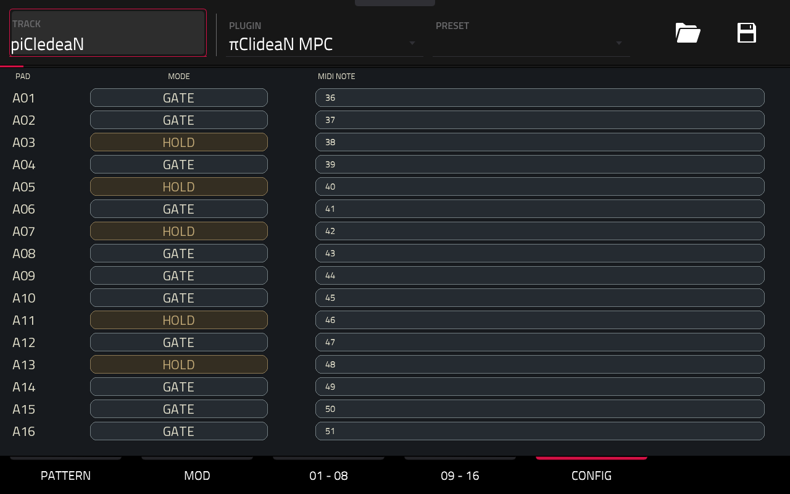

# πClideaN16 MPC — User Manual

Version 1.2.4

## 1. Overview

Sixteen independent lanes generate MIDI notes for a Drum Track or drum instrument. The plugin produces no audio.

Five pages: PATTERN, MOD, 01 - 08, 09 - 16 and CONFIG. A01–A16 select a lane; its white outline stays visible during playback.

## 2. Connect a target

- Load πClideaN on a plugin track and create a separate Drum Track or drum instrument.
- On the target, enable `piClideaN MPC Out` as MIDI input and receive channel 1 or all channels. Each instance has its own port; additional ports are numbered.
- In CONFIG, set each lane’s MIDI NOTE to the note expected by its target sound. Defaults are 36–51; all output uses channel 1.
- Start the host transport. Tempo, position and loops follow the host. Save the host project to retain settings.

Avoid duplicate MIDI input routes and use distinct notes for independent sounds.

## 3. PATTERN — LINE

Select A01–A16, then LINE. The upper row applies to the whole lane:

- VELOCITY: 1–127.
- PROBABILITY: 0–100% chance of playing a trigger group, including its ratchets.
- HUMANIZE: random velocity variation, 0–50, chosen once per group.
- GATE: note duration, 10–95% of a step or ratchet subdivision. Used only in GATE mode.

The lower STEPS row generates the rhythm:

- STEPS: 1–32 steps.
- HITS: 0–STEPS evenly distributed hits.
- ROTATE: circular offset of the generated pattern.
- DIVISION: 1/32, 1/16, 1/8, 1/4 or 1/2 note per step.

Manual trigger edits override the generated pattern. Data beyond the current length remains stored.

MUTE silences the lane; SOLO plays only soloed lanes. Multiple solos are allowed; Mute takes precedence. Active toggles are amber. 1/2 selects a slower division; x2 selects a faster one, within the available range.

### Selective RAND

- Press RAND: it turns green and italic, with a small white dot.
- Tap control areas to include or exclude parameters. Green means selected; values remain unchanged.
- Press RAND again: only selected parameters are randomized, then selection closes.

No selection means no change. Changing lane or LINE/EDIT mode cancels selection. Q-Link editing and 1/2 / x2 are inactive during selection.

All eight LINE controls are eligible. Unselected Hits and Rotate constrain a new Steps value. Changing Steps, Hits or Rotate clears manual trigger overrides; stored step expression is retained. A random result can equal the previous value.

## 4. PATTERN — EDIT

Select EDIT, then a step. LINE is dimmed and read-only; return to LINE to change its defaults. STEP edits the selected step:

- VELOCITY: 1–127, replacing lane velocity.
- PROBABILITY: 0–100%, replacing—not multiplying—lane probability.
- RATCHET: 1–8 hits within the step.
- DECAY: 0–150% velocity multiplier between repeats. 100 keeps velocity constant; 0 leaves only the first hit. Values are limited to 127. No effect with one hit.

Without overrides, velocity and probability follow the lane; ratchet is 1 and decay is 100. A dot marks a stored custom value, even if it equals the lane default. The example shows step 04 with velocity 49 and inherited probability 46%.

SELECT chooses a step without changing its trigger. DRAW toggles the touched trigger. Editing expression alone does not add a note.

ERASE is contextual: in SELECT it clears step-expression overrides; in DRAW it removes the trigger. The other data is retained. Changes are immediate; there is no undo.

## 5. MOD — dual LFO modulation

Choose MOD 1–MOD 4, then assign a PAD through the selection panel. One slot per lane. Defaults: PAD NONE, both LFOs OFF. MOD selection is independent of PATTERN.

Each LFO provides:

- ON/OFF and waveform: Sine, Triangle, Ramp Up/Down, Square, Sample & Hold, Random Smooth or Free Curve.
- SYNC: a tempo-based cycle from 1/16 note to 4 bars. HZ: 0.05–20 Hz.
- DEPTH: −100 to +100; negative values invert the modulation. OFFSET shifts its level; PHASE sets the cycle offset, 0–359°.
- DESTINATION: NONE, Velocity, Probability, Humanize, Gate, Ratchet, Decay or Note On.
- THRESHOLD: the switching level for Note On. Free Curve uses eight sliders.

MIX blends the waveforms: −100 favors LFO 1, 0 blends equally, +100 favors LFO 2. Each LFO retains its destination. An enabled source with destination NONE can still feed the mix.

Parameter modulation affects playback without rewriting stored values. For NOTE ON, an upward threshold crossing starts a note; a downward crossing releases it. While that note is held, step triggers on the same note/channel are suppressed. The sequencer keeps advancing and resumes at the next normal trigger after release.

Previews are static four-bar windows at the current tempo. Relevant edits redraw them; high frequencies use an amplitude band. Random shapes show an example, not the next played sequence. The dashed amber line marks the threshold. Each curve shows an individual source; actual crossings depend on the mixed signal.

OFF and inaudible lanes suspend LFO phase. Re-enabling resumes from that phase without immediately firing a note already above threshold. Reassigning a pad releases its previously owned LFO note.

## 6. Muted lanes and activity

Explicitly muted lane buttons are dimmed. A selected muted lane keeps its white border; selecting it does not unmute it. Solo exclusion alone does not dim selectors.

A01–A16 pulse azure when their emitted notes reach playback time, without changing selection. Muted lanes, solo-excluded lanes, rests and probability-rejected hits do not flash. Pulses last about 140 ms; fast ratchets can merge visually. HOLD flashes on retriggers, not throughout the held note. This is MIDI activity, not measured sound.

Colors and indicators:

- Red step: trigger on. Violet: custom step expression; a violet rest remains silent.
- White outer step border: selection. Red inner border: playhead.
- Amber button: active mode or toggle. Green: RAND selection.
- Small step/control dot: custom expression. Small lane-button dot: enabled modulation destination.

## 7. 01 - 08 / 09 - 16 — playback and rotation

Each page shows eight lanes, 32-step previews and M / S buttons. Select a lane to edit the controls on the right. Mutes and solos act on their own row. Previews retain patterns on muted lanes; the light playback outline is independent of step color.

MODE selects traversal:

- FWD / REV: forward / reverse.
- PEND1: back and forth, repeating endpoints: 1–2–3–4–4–3–2–1.
- PEND2: back and forth without repeated endpoints: 1–2–3–4–3–2.
- URN: every step once per shuffled cycle.

AUTO ROTATE shifts pattern content by SHIFT (−8 to +8 steps) after EVERY (1–16) lane cycles. A cycle follows the playback mode, not necessarily a host bar. Step expression moves with its trigger; the selected step follows its data.

RESET PHASE requests a fresh phase at the next step boundary during playback. CYCLE and SHIFT show current cycle and rotation.

## 8. CONFIG — MIDI notes and GATE / HOLD

MIDI NOTE sets each lane’s output note, 0–127. Tap its MODE button to switch:

- GATE, dark: release each note after the PATTERN GATE duration.
- HOLD, amber: hold until the next effective trigger on that lane; release the old note before retriggering.

For example, at 120 BPM and 1/16 division, a step lasts 125 ms; GATE 50 holds for 62.5 ms. With ratchet 4, it holds each repeat for about 15.6 ms. Host loop boundaries can shorten notes.

In HOLD, rests and probability-rejected hits do not end the note. Ratchets retrigger; the final repeat remains held. The Gate percentage stays stored but is inactive. Switching modes, Stop, Mute and Solo exclusion release owned notes.

HOLD suits long samples or sustained instruments, but cannot extend a finished sample. The target must respond to Note Off; One Shot may ignore it. Two lanes sharing a note/channel are subject to overlap protection.

## 9. Q-Links and automation

On PATTERN:

- LINE: Q1–Q4 = Velocity, Probability, Humanize, Gate; Q5–Q8 = Steps, Hits, Rotate, Division.
- EDIT: Q1–Q4 inactive; Q5–Q8 = step Velocity, Probability, Ratchet, Decay.

MOD: Q1–Q4 = LFO 1 Depth, Offset, Phase, Threshold; Q5–Q8 = the same for LFO 2. MIX uses its separate knob.

The track pages expose lane selection and playback/rotation controls. CONFIG uses touch and the data wheel. A white focus outline identifies the wheel’s target.

Automate canonical lane/step parameters; contextual aliases depend on selection. Existing lane automation still runs in EDIT. Step automation addresses stored source steps, which may move under rotation. Host automation is not MIDI CC input: the plugin does not record or replay CC.

## 10. Save and playback

Save the host project to retain patterns, step expression, note assignments, GATE/HOLD, playback settings and all four MOD slots. Held notes and live LFO phases are not saved. Stop releases owned notes.

Probability is deterministic for a lane seed and musical position; repeating a host loop can repeat its decisions.

The plugin does not create native clips, drive physical pad LEDs or produce audio. See the engine documentation for scheduling limits.
